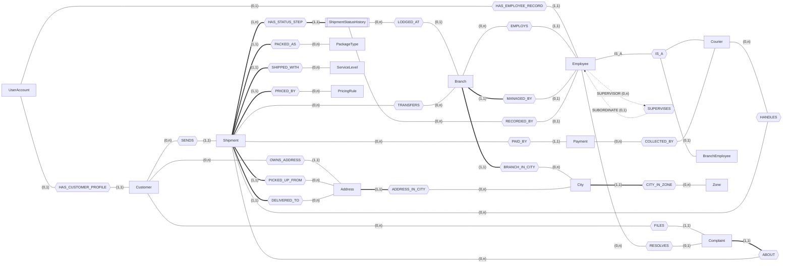
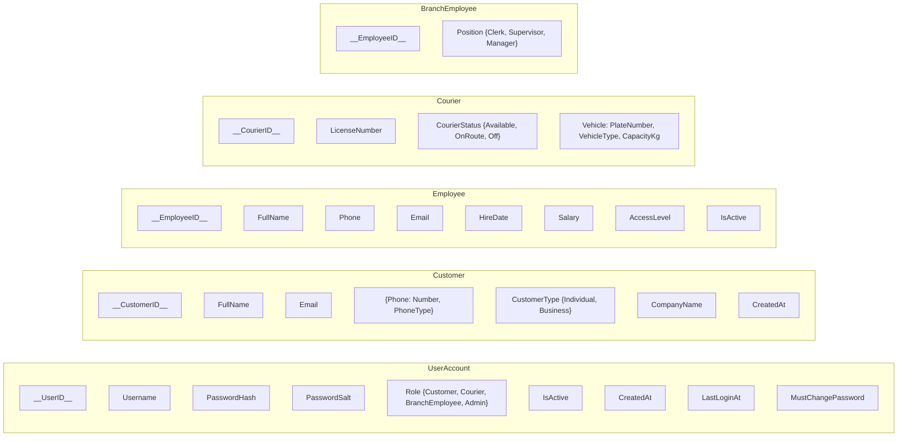
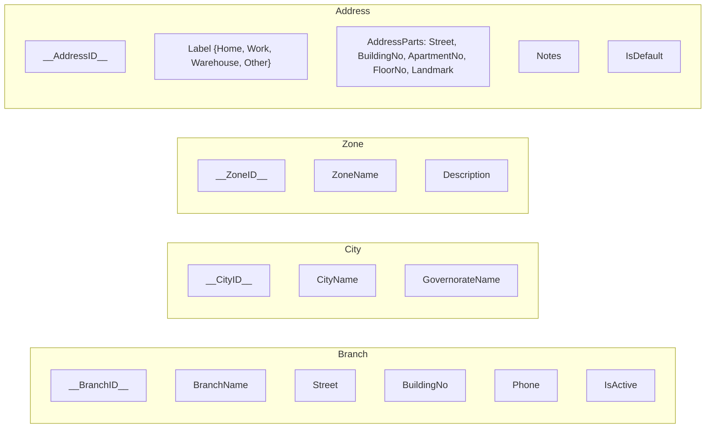
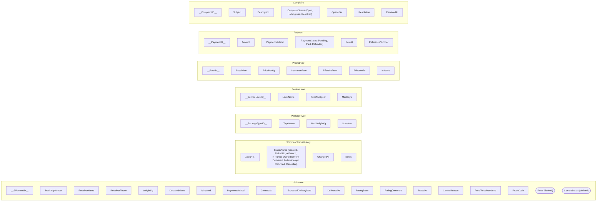

> **Cover page.** The standard cover page in `docs/_COVER_PAGE.md` goes here at export time.
> Report title for this deliverable: **ER Diagram Report** (initial version week 5, final
> version week 7 - this file is kept as one document and the change log at the end says what
> we changed between the two versions).

# ER Diagram Report - SwiftShip

## 1. Problem definition

SwiftShip is a courier company that moves parcels between the Egyptian governorates. The
company wants one system that replaces the paper waybills and the phone calls that are used
today.

The part of the real world we have to model is this:

- A **customer** (a person or a company) asks for a price, books a shipment from one address
  to another, pays for it, follows it while it travels, complains if something goes wrong and
  rates the delivery when it arrives.
- A **shipment** is one parcel. It is created, picked up, moved through one or more
  **branches**, handed to a **courier**, carried, attempted, and finally delivered, returned
  or cancelled. Every one of those steps must be recorded with the time, the place, the
  employee who recorded it and a free-text note, because the customer reads them as a
  timeline and the manager reports on them.
- A **branch** receives parcels, sorts them, hands pickups and deliveries to the couriers who
  belong to that branch, and sends parcels to other branches when the destination is not in
  its own area.
- **Management** does not follow single parcels. It decides the price of a route (from zone
  to zone, per kilogram, per service level), opens branches, hires and moves employees,
  answers complaints, and reads reports.

What makes this a database problem and not a spreadsheet problem is that the interesting
questions are all about **relationships**: which courier handled which shipment, what the
price is from this zone to that zone for this weight and service level, how many shipments
are sitting in a branch, how long a branch takes between receiving and dispatching, which
routes are late. The answer to each of those questions is a join.

## 2. System users and their privileges

| User | Can see | Can do | Cannot do |
|---|---|---|---|
| **Customer** | only his own shipments, addresses, invoices and complaints; the public tracking page | sign up, log in, log out, change password, edit his profile, manage his address book, get a quote, book, track, cancel while `Created`, pay, download an invoice, rate a delivered shipment, file a complaint | see another customer's data, change the status of a shipment, see prices of other customers' shipments, open any employee or admin page |
| **Courier** | only the shipments assigned to him, his own performance and history | log in, change password, see today's tasks, complete a pickup, move a shipment through the allowed statuses, record proof of delivery, record cash collected, filter his history | assign work to himself, see other couriers' tasks, change a price, cancel a shipment, see reports |
| **Branch employee** | the shipments physically in his branch or assigned to couriers of his branch, the complaints about them | log in, change password, receive a shipment, assign a courier of his branch, create a walk-in order, send and receive inter-branch transfers, reschedule or return a failed delivery, answer complaints of his branch, print a waybill | see another branch's data, change prices, create accounts |
| **Admin** | everything | log in, change password, create other admins, create courier and branch-employee accounts, activate/deactivate users, manage branches, cities, zones, package types, service levels and pricing rules, assign vehicles, move employees between branches, close every complaint, override a shipment status with a mandatory reason, read every report, manage customers | nothing is hidden from him |

Privileges are enforced in three places, and all three must agree: the role column of
`UserAccount`, the sidebar the application builds for that role, and an action filter on
every controller that checks the role before the action runs. A courier who types an admin
URL by hand gets the "access denied" page, not the page.

## 3. Entities and what each one represents

Attributes are **not** listed here on purpose (the requirements file asks for a description
only). The full attribute lists are on the diagram pages 2 and 3 and in
`docs/03_Schema_Report.md`.

| # | Entity | What it represents | Strong / weak |
|---|---|---|---|
| 1 | **UserAccount** | the login identity of anybody who signs in. Holds the username, the salted hash of the password, the role and whether the account is active. It is what the file means by "users' data should be stored in a DB table". | strong |
| 2 | **Customer** | an individual or a business that sends shipments. Exists only for the accounts whose role is `Customer`. | strong |
| 3 | **Employee** | the data common to everybody on the payroll: name, phone, hire date, salary, the branch he belongs to and his supervisor. Superclass of Courier and BranchEmployee; an employee whose role is `Admin` has no subclass row. | strong (superclass) |
| 4 | **Courier** | an employee who drives: licence number, availability in the field and the vehicle assigned to him. | subclass of Employee |
| 5 | **BranchEmployee** | an employee who works inside a branch: his position (clerk, supervisor, manager). | subclass of Employee |
| 6 | **Branch** | one physical SwiftShip location. Parcels are received, sorted and dispatched there, and it has a manager who is an employee. | strong |
| 7 | **City** | a city inside an Egyptian governorate. Used for branch locations, addresses, destinations and "top destination cities" reports. | strong |
| 8 | **Zone** | a group of governorates that share the same price table (Greater Cairo, Delta, Canal and Sinai, Upper Egypt...). Prices are set zone-to-zone, not city-to-city, otherwise we would need 27 x 27 rules. | strong |
| 9 | **Address** | a pickup or delivery location: a saved address of a customer (home, work, warehouse) or a one-off address typed for one shipment. | strong |
| 10 | **Shipment** | one parcel moving from a sender to a receiver. Identified by a tracking number, priced by a rule, packed as a package type, carried at a service level. | strong |
| 11 | **ShipmentStatusHistory** | one step in the life of a shipment: the status, the moment it happened, the employee who recorded it, the branch and a note. It has no meaning without its shipment, so it is a weak entity identified by the shipment plus a sequence number. | **weak** (owner: Shipment, partial key: SeqNo) |
| 12 | **PackageType** | the kind of parcel: document, small box, large box, fragile, heavy. Each has a maximum weight and a size note. | strong |
| 13 | **ServiceLevel** | how fast the customer wants it: standard, express or same day. Each has a price multiplier and a promised number of days. | strong |
| 14 | **PricingRule** | the price table: from zone to zone, a base price, a price per kilogram and an insurance rate, valid from a date to a date. Old rules are kept so that the price of an old shipment can still be explained. | strong |
| 15 | **Payment** | money: what a shipment costs, how it was paid (cash on delivery, card, wallet), whether it is pending, paid or refunded, and which courier collected the cash. | strong |
| 16 | **Complaint** | a problem a customer reported about one shipment, the answer the company gave and the employee who closed it. | strong |

Sixteen boxes appear in the diagram, one of which (`UserAccount`) is the authentication
entity the requirements file asks for; the business entities are therefore **15**, inside the
10-15 range the file asks for.

### 3.1 Merges we made, and why

The first draft of the entity list had 21 items. These are the ones we removed and the
reasoning for each:

| Removed | Merged into | Why |
|---|---|---|
| **Admin** (sub-entity) | a *role* of Employee | The requirements file says "sub-entity **or role** of Employee". An admin has no attribute that a branch employee does not have, except an access level, so we put `AccessLevel` on `Employee` and let it be null for non-admins. This also keeps the inheritance triangle to the two real subclasses. |
| **Vehicle** | attributes of Courier | A courier is assigned exactly one vehicle at a time (1:1), and a vehicle has no life of its own in our system - we do not store maintenance, insurance or a trip log. The vehicle therefore became the composite attribute `Vehicle(PlateNumber, VehicleType, CapacityKg)` of Courier, and "assign a vehicle" is an edit on the courier screen. |
| **Rating** | optional attributes of Shipment | One delivery has **at most one** rating, so it is a 1:1 relationship with optional participation on the Shipment side. The mapping algorithm puts the attributes of the 1:1 relationship on the entity of the mandatory side, so `RatingStars`, `RatingComment` and `RatedAt` became attributes of Shipment. The courier being rated is the courier on the delivery assignment. |
| **Status** | an attribute of ShipmentStatusHistory | It is a closed list of nine values, so it is a *lookup*, not a real-world thing. In the ER it is drawn as a simple attribute; at the schema step we normalise it into a `Status` lookup table so that the allowed transitions can be stored next to it. |
| **Assignment** | the relationship `HANDLES` | "Which courier handles which shipment for pickup or delivery" is a many-to-many relationship **with attributes** (type, assigned at, completed at), not an entity. It is drawn as a diamond and becomes its own table at the mapping step. |
| **BranchTransfer** | the ternary relationship `TRANSFERS` | "This shipment moved from branch A to branch B at time T" is a relationship of degree 3 between Shipment and two Branch participations (roles `From` and `To`) with attributes `SentAt` and `ReceivedAt`. It is drawn as a diamond with three edges and becomes its own table at the mapping step. |
| **Governorate** | an attribute of City | A governorate has no attribute except its name and never appears on its own in a query; the reports group by city. It stayed as the `GovernorateName` attribute of City (and Zone groups cities across governorates). |

### 3.2 The special constructs the diagram contains

| Construct | Where it is |
|---|---|
| **Weak entity** | `ShipmentStatusHistory` (double rectangle, identifying relationship `HAS_STATUS_STEP` as a double diamond, partial key `SeqNo` underlined with a dashed underline) |
| **Inheritance** | `Employee` is the superclass, `Courier` and `BranchEmployee` are the subclasses, joined by the `IS_A` triangle; `Admin` is a role of Employee, drawn as a note next to Employee |
| **M:N relationship with attributes** | `HANDLES` between Courier and Shipment, with `AssignmentType`, `AssignedAt`, `CompletedAt` |
| **Ternary relationship** | `TRANSFERS` between Shipment, Branch (role `From`) and Branch (role `To`), with `SentAt`, `ReceivedAt` |
| **Recursive relationship** | `SUPERVISES` between Employee (role `supervisor`) and Employee (role `subordinate`) |
| **Derived attribute** | `Price` of Shipment (derived from the pricing rule, the weight, the service level and the insurance) and `CurrentStatus` of Shipment (derived from the last row of the status history), both drawn with dashed ellipses |
| **Multivalued attribute** | `{Phone}` of Customer - a customer can have a mobile, a landline and a work number. Drawn as a double ellipse and mapped to its own table `CustomerPhone`. |
| **Composite attribute** | `AddressParts(Street, BuildingNo, ApartmentNo, FloorNo, Landmark)` of Address, and `Vehicle(PlateNumber, VehicleType, CapacityKg)` of Courier |

## 4. Relationships and what each one means

Cardinality and participation are written with the **(min, max)** notation of
`DB_Lec03.pdf` (slide 40): the pair next to an entity says how many relationship instances
**that entity** takes part in. Total participation (min = 1) is also drawn with a **double
line** on the edge, so the diagram can be read either way.

| # | Relationship | Participating entities (min, max) | Meaning |
|---|---|---|---|
| R1 | `HAS_CUSTOMER_PROFILE` | UserAccount (0,1) - Customer (1,1) | one login belongs to at most one customer profile, and a customer profile must have exactly one login |
| R2 | `HAS_EMPLOYEE_RECORD` | UserAccount (0,1) - Employee (1,1) | one login belongs to at most one employee record |
| R3 | `IS_A` (inheritance) | Employee (super) - Courier (0,1), BranchEmployee (0,1) | an employee is either a courier, a branch employee, or an admin (admin = role, so no subclass row) |
| R4 | `SUPERVISES` (recursive) | Employee as *supervisor* (0,n) - Employee as *subordinate* (0,1) | every employee reports to at most one supervisor; a supervisor can have many subordinates |
| R5 | `EMPLOYS` | Branch (0,n) - Employee (1,1) | every employee belongs to exactly one branch; a branch has many employees (admins belong to the head-office branch) |
| R6 | `MANAGED_BY` | Branch (1,1) - Employee (0,1) | every branch has exactly one manager, and an employee manages at most one branch |
| R7 | `BRANCH_IN_CITY` | Branch (1,1) - City (0,n) | a branch is located in exactly one city; a city can host several branches |
| R8 | `CITY_IN_ZONE` | City (1,1) - Zone (0,n) | every city belongs to exactly one pricing zone |
| R9 | `OWNS_ADDRESS` | Customer (0,n) - Address (1,1) | a customer keeps an address book; an address belongs to one customer or to nobody (one-off addresses typed for a shipment) |
| R10 | `ADDRESS_IN_CITY` | Address (1,1) - City (0,n) | an address is inside exactly one city |
| R11 | `SENDS` | Customer (0,n) - Shipment (1,1) | a shipment has exactly one sender customer |
| R12 | `PICKED_UP_FROM` | Shipment (1,1) - Address (0,n) | the origin address of a shipment |
| R13 | `DELIVERED_TO` | Shipment (1,1) - Address (0,n) | the destination address of a shipment |
| R14 | `PACKED_AS` | Shipment (1,1) - PackageType (0,n) | every shipment is one package type |
| R15 | `SHIPPED_WITH` | Shipment (1,1) - ServiceLevel (0,n) | every shipment is carried at one service level |
| R16 | `PRICED_BY` | Shipment (1,1) - PricingRule (0,n) | every shipment is priced by exactly one rule, the one that was valid when it was booked |
| R17 | `HAS_STATUS_STEP` (identifying) | Shipment (1,n) - ShipmentStatusHistory (1,1) | a shipment has at least one status step (the `Created` one); a step exists only for its shipment |
| R18 | `RECORDED_BY` | ShipmentStatusHistory (0,n) - Employee (0,1) | the employee who recorded the step (null when the customer himself cancelled) |
| R19 | `LODGED_AT` | ShipmentStatusHistory (0,n) - Branch (0,1) | the branch where the step happened (null for steps in the field) |
| R20 | `HANDLES` (M:N) | Courier (0,n) - Shipment (0,n) | which courier does the pickup or the delivery of which shipment |
| R21 | `TRANSFERS` (ternary) | Shipment (0,n) - Branch as *From* (0,n) - Branch as *To* (0,n) | one leg of an inter-branch move |
| R22 | `PAID_BY` | Shipment (0,n) - Payment (1,1) | a shipment can have no payment yet (cash on delivery) and at most one refund record on top of the main payment; a payment belongs to one shipment |
| R23 | `COLLECTED_BY` | Payment (0,n) - Courier (0,1) | the courier who collected the cash of a cash-on-delivery shipment |
| R24 | `FILES` | Customer (0,n) - Complaint (1,1) | a complaint is filed by exactly one customer |
| R25 | `ABOUT` | Complaint (1,1) - Shipment (0,n) | a complaint is always about one shipment |
| R26 | `RESOLVES` | Employee (0,n) - Complaint (0,1) | the employee who answered and closed the complaint |

### 4.1 Attributes attached to relationships

Relationship attributes are drawn on **page 1** of the diagram (the requirements file asks
for that) and are listed here as well:

| Relationship | Attributes |
|---|---|
| `HANDLES` | `AssignmentType` (Pickup / Delivery), `AssignedAt`, `CompletedAt`, `Notes` |
| `TRANSFERS` | `SentAt`, `ReceivedAt`, `Notes` |
| `MANAGED_BY` | `StartDate` (kept on the Branch side as an attribute in the schema) |

## 5. The ER diagram

The diagram is delivered in three interchangeable sources, all in `docs/er/`:

| File | What it is good for |
|---|---|
| `docs/er/er_diagram.drawio` | **the main deliverable** - open it with the free draw.io / diagrams.net app or the web editor. Page 1 is "entities and relationships", page 2 and page 3 are the attributes per entity. Export to PDF or PNG from there. |
| `docs/er/er_diagram.puml` | PlantUML source, one diagram with all the attributes on it. Paste it into any PlantUML renderer. |
| `docs/er/er_relationships.mmd` and `docs/er/er_attributes.mmd` | Mermaid sources, rendered automatically by GitHub and by most markdown viewers. |

### 5.1 Notation legend (from `DB_Lec03.pdf`)

| Symbol | Meaning |
|---|---|
| rectangle | entity type |
| double rectangle | weak entity type |
| diamond | relationship type |
| double diamond | identifying relationship of a weak entity |
| ellipse | attribute |
| underlined attribute name | key attribute |
| dashed-underlined attribute name | partial key of a weak entity |
| double ellipse | multivalued attribute |
| dashed ellipse | derived attribute |
| ellipse with children | composite attribute |
| triangle | inheritance (superclass at the top, subclasses below) |
| double line on an edge | total participation (existence dependency) |
| `(min, max)` near an entity | structural constraint of that participation |
| role name on an edge | needed when the same entity participates twice |

### 5.2 Page 1 - entities and relationships (rendered with Mermaid)

Notes on reading the rendering above:

- `===` is a **thick** link and stands for the **double line** of total participation.
- `{{...}}` is a hexagon because Mermaid has no diamond-in-the-middle-of-an-edge; in the
  draw.io file these are real diamonds.
- `[[...]]` is the double rectangle of the weak entity.
- `TRANSFERS` is a ternary relationship: its third edge to `Branch` (role `To`) is drawn as
  the second `BR` connection, and the draw.io file labels the two roles `From` and `To`.
- `Admin` is not a box: it is the `Role` attribute of `UserAccount` plus the `AccessLevel`
  attribute of `Employee`.

### 5.3 Pages 2 and 3 - attributes of every entity

Rendered here with Mermaid as well; the draw.io file has the same content drawn with real
ellipses, including the double ellipse of `{Phone}`, the dashed ellipses of `Price` and
`CurrentStatus`, and the composite attribute trees.

**Customer, UserAccount, Employee and its subclasses**

**Branch, City, Zone, Address**

**Shipment, its weak entity, lookups, money and complaints**

## 6. Assumptions and restrictions

State explicitly, as the requirements file asks:

1. **One parcel per shipment.** A shipment is one physical parcel. Multi-parcel orders do
   not exist, so there is no "order" entity between Customer and Shipment.
2. **Egypt only.** Cities are Egyptian cities; prices are in EGP.
3. **The price is frozen at booking time.** The shipment keeps a reference to the pricing
   rule that was valid when it was booked, and the price is stored on the shipment. When the
   admin changes a rule, old shipments do not change price. Old rules are never deleted, only
   expired (`EffectiveTo`), so the price history can be reported.
4. **A customer pays once per shipment.** Cash on delivery starts as `Pending` and becomes
   `Paid` when the courier records the cash. Card and wallet payments are `Paid` at booking.
   A cancelled shipment produces a second `Refunded` payment row, which is the reason `PAID_BY`
   is 1:N from the shipment side and not 1:1.
5. **A status step is never deleted or edited.** The status history is append only. If a
   status was recorded by mistake, the admin adds a corrected step with a mandatory reason
   instead of changing the old one, so the audit trail stays honest.
6. **The allowed status order is data, not code.** The list of legal transitions lives in a
   `StatusTransition` lookup table, so the admin can add a transition without a new release.
7. **One courier per pickup and one per delivery.** The same courier may do both, but they
   are two assignments. A shipment cannot be delivered before it was picked up.
8. **Ratings are one per shipment and only after `Delivered`.** A customer cannot rate twice
   and cannot rate a shipment that is not his.
9. **The first admin is created by the seed script** with the username `admin` and a hashed
   password; the application forces him to change it at the first login. Every other account
   is created from inside the application.
10. **Addresses used only once are still rows.** A receiver address typed during booking is
    stored as an `Address` row whose customer is null, so that the shipment has a real
    foreign key and the courier sees a full address.
11. **An employee's branch is mandatory.** Admins are employees of the head-office branch,
    which is why `EMPLOYS` has total participation on the Employee side.
12. **Time zone.** All timestamps are stored in UTC and shown in the local time of the
    server; reports group by month using the shipment creation date.

## 7. Change log between the initial and the final version

| What changed | Why |
|---|---|
| `Rating` was an entity, now it is an attribute of `Shipment` | 1:1 relationship with optional participation, so the mapping algorithm merges it |
| `Vehicle` was an entity, now it is a composite attribute of `Courier` | one vehicle per courier, and the vehicle has no independent life in the system |
| `Status` became an attribute of the weak entity, and will become a lookup table in the schema | it is a closed list of nine values |
| `BranchTransfer` became the ternary relationship `TRANSFERS` | it really connects a shipment with two branches at once |
| `SUPERVISES` was added | the recursive relationship the ER must contain |
| `Zone` was added | pricing city-to-city would need 27 x 27 rules; zone-to-zone needs 16 |
| `Price` and `CurrentStatus` are marked derived | they can be recomputed from the rule and from the history |
| `{Phone}` of Customer is marked multivalued | a customer really has more than one phone number |
