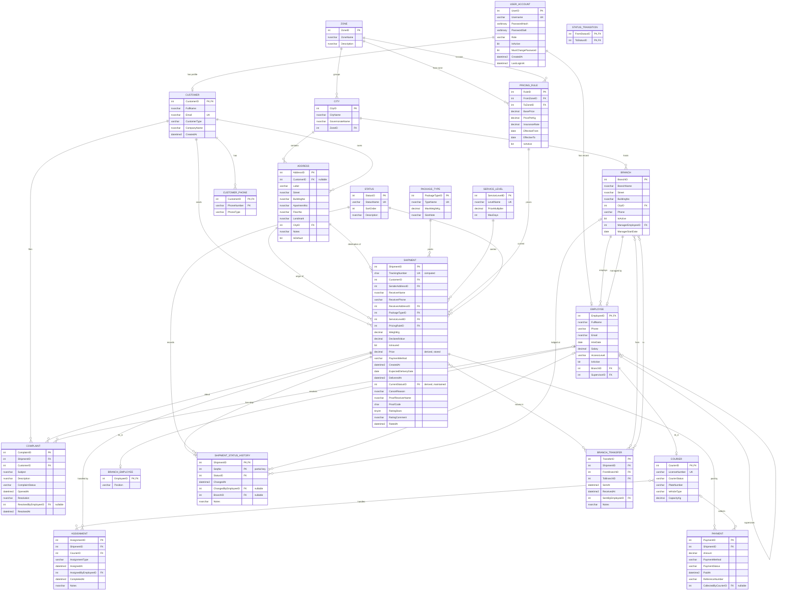

> **Cover page.** The standard cover page in `docs/_COVER_PAGE.md` goes here at export time.
> Report title for this deliverable: **Database Schema Report**.
> The approved ER diagram this report starts from is `docs/er/er_diagram.drawio`
> (final version, week 7).

# Database Schema Report - SwiftShip

## 1. What this report contains

1. the final ER diagram we are mapping from (same file as phase B, final version),
2. the mapping from the ER to the relational schema, **step by step**, using the algorithm of
   the lectures and of the textbook (`DB_Lec03.pdf` + Elmasri/Navathe chapter 9), showing
   which step produced which table,
3. the schema diagram with primary keys and the foreign key arrows,
4. the normalisation argument (why the schema is in 3NF),
5. the SQL Server DDL itself: `db/01_create_tables.sql`.

## 2. The mapping, step by step

### Step 1 - regular (strong) entity types

*Rule:* for every strong entity type create one relation. Its simple attributes become
columns, the key attribute becomes the primary key, the components of a composite attribute
become columns in place of the composite attribute itself, and a derived attribute is left
out of the relation (we keep two of them as computed columns, see the note below).

| Entity | Relation produced | Notes |
|---|---|---|
| UserAccount | `UserAccount` | PK `UserID` (surrogate, identity) |
| Customer | `Customer` | PK `CustomerID` |
| Employee | `Employee` | PK `EmployeeID`; the recursive `SUPERVISES` becomes the column `SupervisorID` (step 4) |
| Branch | `Branch` | PK `BranchID`; `Street` and `BuildingNo` are the only parts we kept of its address |
| City | `City` | PK `CityID` |
| Zone | `Zone` | PK `ZoneID` |
| Address | `Address` | PK `AddressID`; the composite `AddressParts(Street, BuildingNo, ApartmentNo, FloorNo, Landmark)` became five columns |
| Shipment | `Shipment` | PK `ShipmentID`; `TrackingNumber` is a computed column `'SS-' + 6 digits` |
| PackageType | `PackageType` | PK `PackageTypeID` |
| ServiceLevel | `ServiceLevel` | PK `ServiceLevelID` |
| PricingRule | `PricingRule` | PK `RuleID` |
| Payment | `Payment` | PK `PaymentID` |
| Complaint | `Complaint` | PK `ComplaintID` |

**Derived attributes.** `Price` and `CurrentStatus` are dashed ellipses in the ER, so strictly
speaking they should not appear in a relation. We make an explicit exception and document it:
`Price` is stored because the price must stay frozen when the admin changes a pricing rule,
and `CurrentStatus` is stored because every list and every dashboard filters on it. Both are
kept correct by the code: `Price` is written once at booking time by `usp_CreateShipment`,
and `CurrentStatus` is written by `trg_ShipmentStatusHistory_SyncCurrent` from the history
rows, so it can never disagree with the history it is derived from.

### Step 2 - weak entity types

*Rule:* for every weak entity type create a relation with all its attributes plus the primary
key of the owner as a foreign key. The primary key of the new relation is the owner's key
**plus the partial key**. Cascade the delete.

| Weak entity | Owner | Relation produced | Primary key |
|---|---|---|---|
| ShipmentStatusHistory | Shipment | `ShipmentStatusHistory` | `(ShipmentID, SeqNo)` |

`SeqNo` is the partial key, so it is not unique on its own - every shipment has its own
1, 2, 3... `ON DELETE CASCADE`: a deleted shipment takes its history with it, because a
history row has no meaning without its shipment.

### Step 3 - binary 1:1 relationships

*Rule:* take the relation of the entity that participates **totally** and put the primary key
of the other one into it as a foreign key. When the two relations describe the same real
object (which is our case), the two are merged into one relation and the foreign key becomes
the primary key.

| Relationship | Decision | Result |
|---|---|---|
| `HAS_CUSTOMER_PROFILE` (UserAccount 0,1 - Customer 1,1) | merge; Customer participates totally | `Customer.CustomerID` is both the PK and a FK to `UserAccount.UserID` |
| `HAS_EMPLOYEE_RECORD` (UserAccount 0,1 - Employee 1,1) | merge; Employee participates totally | `Employee.EmployeeID` is both the PK and a FK to `UserAccount.UserID` |
| `MANAGED_BY` (Branch 1,1 - Employee 0,1) | Branch participates totally | `Branch.ManagerEmployeeID` FK, plus the relationship attribute `StartDate` as `Branch.ManagerStartDate` |

### Step 4 - binary 1:N relationships

*Rule:* put the primary key of the 1-side into the relation of the N-side as a foreign key.
Any attribute of the relationship moves to the N-side too.

| Relationship | 1-side | N-side relation and column |
|---|---|---|
| `EMPLOYS` | Branch | `Employee.BranchID` |
| `SUPERVISES` (recursive) | Employee | `Employee.SupervisorID` |
| `BRANCH_IN_CITY` | City | `Branch.CityID` |
| `CITY_IN_ZONE` | Zone | `City.ZoneID` |
| `OWNS_ADDRESS` | Customer | `Address.CustomerID` (nullable: one-off addresses belong to nobody) |
| `ADDRESS_IN_CITY` | City | `Address.CityID` |
| `SENDS` | Customer | `Shipment.CustomerID` |
| `PICKED_UP_FROM` | Address | `Shipment.SenderAddressID` |
| `DELIVERED_TO` | Address | `Shipment.ReceiverAddressID` |
| `PACKED_AS` | PackageType | `Shipment.PackageTypeID` |
| `SHIPPED_WITH` | ServiceLevel | `Shipment.ServiceLevelID` |
| `PRICED_BY` | PricingRule | `Shipment.PricingRuleID` |
| `RECORDED_BY` | Employee | `ShipmentStatusHistory.ChangedByEmployeeID` (nullable) |
| `LODGED_AT` | Branch | `ShipmentStatusHistory.BranchID` (nullable) |
| `PAID_BY` | Shipment | `Payment.ShipmentID` |
| `COLLECTED_BY` | Courier | `Payment.CollectedByCourierID` (nullable) |
| `FILES` | Customer | `Complaint.CustomerID` |
| `ABOUT` | Shipment | `Complaint.ShipmentID` |
| `RESOLVES` | Employee | `Complaint.ResolvedByEmployeeID` (nullable) |

`ShipmentStatusHistory.StatusID` is not in this list: `Status` is not an entity in the ER, it
is an attribute of the weak entity. **At the schema step we normalise it** into a lookup
relation `Status(StatusID, StatusName, SortOrder)` so that the nine values exist once, so
that they can be ordered for the timeline, and so that `StatusTransition` can refer to them.
That is a schema-level improvement, not part of the ER mapping.

### Step 5 - binary M:N relationships

*Rule:* create a new relation. Its primary key is the combination of the primary keys of the
two participating entities (both are foreign keys), and it carries the attributes of the
relationship.

| Relationship | Relation produced | Primary key | Relationship attributes |
|---|---|---|---|
| `HANDLES` (Courier 0,n - Shipment 0,n) | `Assignment` | `AssignmentID` (surrogate; `UNIQUE (ShipmentID, AssignmentType) WHERE CompletedAt IS NULL`) | `AssignmentType`, `AssignedAt`, `CompletedAt`, `Notes`, `AssignedByEmployeeID` |

We used a surrogate key instead of `(ShipmentID, CourierID)` because the same courier can be
assigned to the same shipment twice in its life (once for the pickup and once for the
delivery). The **filtered unique index** is what enforces the real business rule: at most one
*open* assignment per shipment and per type. Without it, two branch employees pressing
"assign" at the same moment would both succeed; with it, the database rejects the second
`INSERT` with a duplicate-key error, the stored procedure rolls back, and the user sees a
clean message instead of two couriers driving to the same door.

### Step 6 - multivalued attributes

*Rule:* create a new relation with the multivalued attribute plus the primary key of the
entity; the primary key of the new relation is the combination of both.

| Multivalued attribute | Relation produced | Primary key |
|---|---|---|
| `Customer {Phone (Number, PhoneType)}` | `CustomerPhone` | `(CustomerID, PhoneNumber)` |

The composite component `PhoneType` stayed as a column of `CustomerPhone`, and the components
of the composite multivalued attribute are therefore `(PhoneNumber, PhoneType)`.

### Step 7 - n-ary relationships (n > 2)

*Rule:* create a new relation whose primary key is the combination of the primary keys of all
participating entity types, all of them foreign keys, plus the attributes of the
relationship.

| Relationship | Degree | Relation produced | Foreign keys |
|---|---|---|---|
| `TRANSFERS` (Shipment, Branch as *From*, Branch as *To*) | 3 (ternary) | `BranchTransfer` | `ShipmentID`, `FromBranchID`, `ToBranchID` (all FK) |

Attributes: `SentAt`, `ReceivedAt`, `Notes`, `SentByEmployeeID`. A surrogate `TransferID` is
the primary key because the same pair of branches can legitimately appear twice for one
shipment if the parcel is sent back and forth.

### Step 8 - superclass / subclass (Appendix A of the requirements file)

*Rule:* create a relation for the superclass with its own attributes and its own primary key.
Create a relation for **each** subclass with its own attributes, and make its primary key the
same attribute, which is at the same time a foreign key to the superclass.

| Relation | Primary key | Foreign key |
|---|---|---|
| `Employee` (superclass) | `EmployeeID` | `EmployeeID -> UserAccount.UserID`, `BranchID -> Branch`, `SupervisorID -> Employee` |
| `Courier` (subclass) | `CourierID` | `CourierID -> Employee.EmployeeID` |
| `BranchEmployee` (subclass) | `EmployeeID` | `EmployeeID -> Employee.EmployeeID` |

`Admin` has no relation of its own: it is a **role**, stored as `UserAccount.Role = 'Admin'`
with the extra attribute `Employee.AccessLevel`. The requirements file allows this ("sub-entity
**or role** of Employee"), and a trigger (`trg_Employee_AccessLevelOnlyForAdmins`) makes sure
only an account whose role is `Admin` can carry an access level.

The ER triangle also has a disjointness aspect. We do **not** enforce it with a constraint on
purpose: an employee can be a branch employee today and a courier after a transfer, and the
history tables still point at him. What we do enforce is the useful half: a courier cannot
pick up a shipment before the branch received it, and a shipment cannot be delivered by
somebody who is not the courier on the delivery assignment.

### Summary - one row per relation

| # | Relation | From step | Primary key | Foreign keys |
|---|---|---|---|---|
| 1 | `Status` | lookup (step 4 note) | `StatusID` | - |
| 2 | `StatusTransition` | lookup | `(FromStatusID, ToStatusID)` | both -> `Status` |
| 3 | `Zone` | 1 | `ZoneID` | - |
| 4 | `City` | 1 + 4 | `CityID` | `ZoneID` -> `Zone` |
| 5 | `UserAccount` | 1 | `UserID` | - |
| 6 | `Customer` | 1 + 3 | `CustomerID` | `CustomerID` -> `UserAccount` |
| 7 | `CustomerPhone` | 6 | `(CustomerID, PhoneNumber)` | `CustomerID` -> `Customer` |
| 8 | `Employee` | 1 + 3 + 4 + 8 | `EmployeeID` | -> `UserAccount`, -> `Branch`, -> `Employee` |
| 9 | `Courier` | 8 | `CourierID` | -> `Employee` |
| 10 | `BranchEmployee` | 8 | `EmployeeID` | -> `Employee` |
| 11 | `Branch` | 1 + 3 + 4 | `BranchID` | `CityID` -> `City`, `ManagerEmployeeID` -> `Employee` |
| 12 | `Address` | 1 + 4 | `AddressID` | -> `Customer`, -> `City` |
| 13 | `PackageType` | 1 | `PackageTypeID` | - |
| 14 | `ServiceLevel` | 1 | `ServiceLevelID` | - |
| 15 | `PricingRule` | 1 | `RuleID` | `FromZoneID`, `ToZoneID` -> `Zone` |
| 16 | `Shipment` | 1 + 4 | `ShipmentID` | -> `Customer`, -> `Address` (x2), -> `PackageType`, -> `ServiceLevel`, -> `PricingRule`, -> `Status` |
| 17 | `ShipmentStatusHistory` | 2 | `(ShipmentID, SeqNo)` | -> `Shipment`, -> `Status`, -> `Employee`, -> `Branch` |
| 18 | `Assignment` | 5 | `AssignmentID` | -> `Shipment`, -> `Courier`, -> `Employee` |
| 19 | `BranchTransfer` | 7 | `TransferID` | -> `Shipment`, -> `Branch` (x2), -> `Employee` |
| 20 | `Payment` | 1 + 4 | `PaymentID` | -> `Shipment`, -> `Courier` |
| 21 | `Complaint` | 1 + 4 | `ComplaintID` | -> `Shipment`, -> `Customer`, -> `Employee` |

21 relations, of which 15 come from the 15 real-world entities of the ER, one is the
authentication entity the requirements file asks for (`UserAccount`), two come from
relationships with attributes (`Assignment`, `BranchTransfer`), one from the multivalued
attribute (`CustomerPhone`), and two are lookups (`Status`, `StatusTransition`).

## 3. Schema diagram

Primary keys are marked `PK`, foreign keys `FK`, and every arrow points from the referencing
relation to the relation it references.



The same diagram, as text arrows, in case the rendering above is not available:

```
UserAccount <---- Customer          (Customer.CustomerID -> UserAccount.UserID)
UserAccount <---- Employee          (Employee.EmployeeID -> UserAccount.UserID)
Employee    <---- Courier           (Courier.CourierID   -> Employee.EmployeeID)
Employee    <---- BranchEmployee    (BranchEmployee.EmployeeID -> Employee.EmployeeID)
Employee    <---- Employee          (Employee.SupervisorID -> Employee.EmployeeID)
Branch      <---- Employee          (Employee.BranchID -> Branch.BranchID)
Employee    <---- Branch            (Branch.ManagerEmployeeID -> Employee.EmployeeID)
Zone        <---- City              (City.ZoneID -> Zone.ZoneID)
Zone        <---- PricingRule       (PricingRule.FromZoneID / ToZoneID -> Zone.ZoneID)
City        <---- Branch            (Branch.CityID -> City.CityID)
City        <---- Address           (Address.CityID -> City.CityID)
Customer    <---- CustomerPhone     (CustomerPhone.CustomerID -> Customer.CustomerID)
Customer    <---- Address           (Address.CustomerID -> Customer.CustomerID)
Customer    <---- Shipment          (Shipment.CustomerID -> Customer.CustomerID)
Address     <---- Shipment          (Shipment.SenderAddressID, ReceiverAddressID -> Address.AddressID)
PackageType <---- Shipment          (Shipment.PackageTypeID -> PackageType.PackageTypeID)
ServiceLevel<---- Shipment          (Shipment.ServiceLevelID -> ServiceLevel.ServiceLevelID)
PricingRule <---- Shipment          (Shipment.PricingRuleID -> PricingRule.RuleID)
Status      <---- Shipment          (Shipment.CurrentStatusID -> Status.StatusID)
Shipment    <---- ShipmentStatusHistory (ShipmentID -> Shipment.ShipmentID)
Status      <---- ShipmentStatusHistory (StatusID -> Status.StatusID)
Employee    <---- ShipmentStatusHistory (ChangedByEmployeeID -> Employee.EmployeeID)
Branch      <---- ShipmentStatusHistory (BranchID -> Branch.BranchID)
Shipment    <---- Assignment        (Assignment.ShipmentID -> Shipment.ShipmentID)
Courier     <---- Assignment        (Assignment.CourierID -> Courier.CourierID)
Shipment    <---- BranchTransfer    (BranchTransfer.ShipmentID -> Shipment.ShipmentID)
Branch      <---- BranchTransfer    (FromBranchID, ToBranchID -> Branch.BranchID)
Shipment    <---- Payment           (Payment.ShipmentID -> Shipment.ShipmentID)
Courier     <---- Payment           (Payment.CollectedByCourierID -> Courier.CourierID)
Shipment    <---- Complaint         (Complaint.ShipmentID -> Shipment.ShipmentID)
Customer    <---- Complaint         (Complaint.CustomerID -> Customer.CustomerID)
Employee    <---- Complaint         (Complaint.ResolvedByEmployeeID -> Employee.EmployeeID)
Status      <---- StatusTransition  (FromStatusID, ToStatusID -> Status.StatusID)
```

## 4. Is the schema in 3NF?

Yes, and this is why. **First normal form:** every column holds one atomic value, there are no
repeating groups, and the two things that were not atomic in the real world were taken out -
the multivalued `{Phone}` became `CustomerPhone`, and the composite `AddressParts` was split
into five columns. **Second normal form:** every relation except two has a single-column
surrogate primary key, so a partial dependency on part of a key is impossible; the two
relations with a composite key are `ShipmentStatusHistory`, whose only non-key columns
(`StatusID`, `ChangedAt`, the employee, the branch, the note) describe the whole step and not
just the shipment or just the sequence number, and `CustomerPhone`, whose only non-key column
`PhoneType` describes the whole (customer, phone) pair. **Third normal form:** no non-key
column depends on another non-key column. The three places where that could have happened are
the ones we designed around on purpose: (1) the city name is not stored on the branch or on
the address, only `CityID`, so a renamed city is corrected in one row; (2) the shipment stores
`Price` and `PricingRuleID` but not the base price or the price per kilogram, so those live
only in `PricingRule`; (3) `Shipment.CurrentStatusID` is a denormalisation of the last history
row, which is a deliberate, documented exception - it is a derived attribute kept in sync by a
trigger, chosen because every dashboard and every "my shipments" list filters on it, and the
trigger makes it impossible for it to contradict the history it comes from.

## 5. Constraints that carry business rules

| Rule | Where it is enforced |
|---|---|
| the nine statuses | `Status` lookup + `ShipmentStatusHistory.StatusID` FK |
| a status can only move along an allowed transition | `StatusTransition` table, read by `dbo.usp_AddStatusUpdate` |
| the history is append only | there is no update or delete granted on `ShipmentStatusHistory`; corrections go through `usp_AdminOverrideStatus` |
| a shipment can only be cancelled while `Created` | `usp_CancelShipment` + `StatusTransition` |
| a rating only after `Delivered`, and only one | `CK_Shipment_RatingNeedsDelivery` + `usp_RateShipment` |
| one open assignment per shipment and per type | `UX_Assignment_OneOpenPerType` filtered unique index |
| one OTP per delivery | `Shipment.ProofCode`, written at booking, checked by `usp_DeliverShipment` |
| a business customer must have a company name, an individual must not | `CK_Customer_CompanyName` |
| a sender address is never the receiver address | `CK_Shipment_SenderNotReceiver` |
| an employee is not his own supervisor | `CK_Employee_NotSelfSupervisor` |
| only admins have an access level | `trg_Employee_AccessLevelOnlyForAdmins` |
| a customer profile only for a `Customer` account | `trg_Customer_OnlyForCustomerRole` |
| a resolved complaint has a resolution, an employee and a date | `CK_Complaint_ResolvedComplete` |
| a paid payment has a payment date | `CK_Payment_PaidHasDate` |
| a transfer goes between two different branches | `CK_Transfer_DifferentBranches` |

## 6. How passwords are stored

`UserAccount` holds `PasswordHash VARBINARY(64)` and `PasswordSalt VARBINARY(32)`. When a user
is created, the application generates 32 random bytes of salt with
`RandomNumberGenerator.Fill`, derives 64 bytes with **PBKDF2-HMAC-SHA256, 100 000 iterations**
(`Rfc2898DeriveBytes`), and stores the two. Nothing else is stored: no plain password, no
reversible encryption. At login the same derivation is run on the password the user typed and
the two hashes are compared with a fixed-time comparison.

The first admin is the only account created outside the application: `db/02_seed_data.sql`
inserts it with a hash produced by the same algorithm, and `MustChangePassword = 1`, so the
application shows the change-password screen right after the first login. The seed script also
prints a warning telling the reader to change it immediately.

## 7. How to create the database

```
sqlcmd -S localhost -E -i db\01_create_tables.sql
sqlcmd -S localhost -E -i db\02_seed_data.sql
sqlcmd -S localhost -E -i db\03_queries.sql
```

or open the three files in SQL Server Management Studio and press F5, in that order.
`db/04_final_backup_instructions.md` explains how to back the database up and restore it on
another machine.
